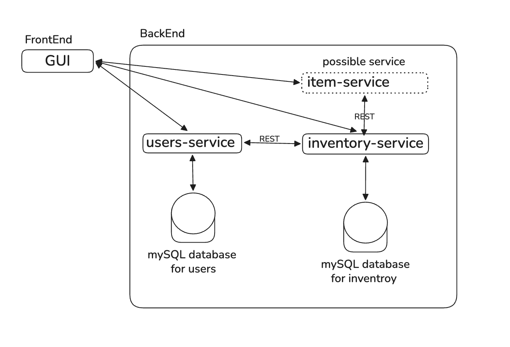

# Cloud-Native Game Item Inventory Management System: TetherPack

| | |
|---|---|
| **Name** | Alja Eremic |
| **Group Name** | TetherPack |
| **Group Number** | Individual |
| **Repository** | [link](https://github.com/orgs/TetherPack) |
| **Date** | 26.10.2026 |

## 1. Project Design

**Description:**
TetherPack is a cloud-native microservice application that stores players' game inventories centrally, so their items persist across sessions and game servers. It is inspired by how large MMO keep player data on central servers instead of on the player's device.

## 2. Use Cases

### Basic

1. **Create Player:** A new player is registered in the system. Each player represents one owner of an inventory, so creating a player is the starting point for every other action.
2. **List Players:** A user can browse all players currently registered in the system and select one to inspect.
3. **View Inventory:** A player can see the items they own, including each item's name, type, rarity and quantity.
4. **Manipulate Inventory:** A player's inventory can be changed in its most basic form by adding an item to it or removing an item from it.

### Advanced (stretch goals)

1. **Manipulate Inventory: Item Trade:** Two players exchange items. Both players are validated, and the transfer is completed as a single operation so an item is never lost or duplicated.
2. **Manipulate Inventory: Item Drop:** A player drops an item into a shared pool, from which any other player can pick it up. This models items lying in the game world.
3. **Inventory History:** A player can view a chronological record of every change to their inventory, such as items added, removed, traded or dropped.
4. **Add New Item:** A new item definition can be added to the item catalog, so it can later be given to players.
5. **Update Player:** The details of an existing player, such as the username, can be edited.

## 3. Architecture Diagram

## 4. Microservices

TetherPack consists of three components: a GUI and two microservices, with a possible third microservice planned for the future. Each microservice owns its own database and communicates with the others only through its API.

**users-service:** Responsible for everything related to players. It creates, lists, retrieves and updates player records, and it is the single source of truth for whether a player exists. It stores its data in its own MySQL database and is designed with multitenancy in mind, so that several games or worlds could share the system while keeping their players separate.

**inventory-service:** Responsible for items and inventories. It keeps track of which items exist, which player owns which items, and in what quantity. It also handles the rules around changing ownership, such as which items can be dropped or traded. It stores its data in its own MySQL database and calls users-service over REST to check that a player exists, never reading the users database directly.

**item-service (possible future service):** A planned microservice dedicated to the details of individual items, such as models, colors, durability and rarity. For now this information lives in the item catalog of the inventory-service, and it would only be separated out if the project grows.

## 5. Development Environment

### Tech Stack

- **Cloud platform: Microsoft Azure.** The application runs on a Kubernetes cluster in Azure, making it publicly accessible.
- **Frontend: React.** Builds the GUI as reusable components, with subpages for the player list and the inventory view, calling the backend via REST.
- **Backend: Python with FastAPI.** Both microservices expose REST APIs, validate requests automatically, and generate interactive API documentation.
- **Databases: MySQL.** Each microservice has its own database, so the services stay independent.
- **Infrastructure as code: Terraform.** Defines the cloud infrastructure, such as the Kubernetes cluster, in code so it can be rebuilt repeatedly.

### Organization and Repositories

The project's source code and documentation are hosted on GitHub, in a dedicated organization containing a repository for each component (GUI, users-service, inventory-service and infrastructure). Each repository has a README with setup instructions and uses a MAIN branch for stable code and a DEV branch for ongoing development.

## 6. Planned Requirements
Planned requirements to be extended in the future to reach the 50% needed to pass.

| # | Requirement | Type | Points (%) |
|---|---|---|---|
| 1 | Repository | Mandatory | 2 |
| 2 | Microservices and Cloud-Native Application | Mandatory | 5 |
| 3 | Database per Microservice | Mandatory | 3 |
| 4 | Documentation | Mandatory | 3 |
| 8 | Cloud Deployment | Mandatory | 6 |
| 15 | Graphical User Interface | Mandatory | 5 |
| 5 | API Documentation | Optional | 4 |
| 10 | Multitenancy | Optional | 6 |
| 11 | Health Checks | Optional | 5 |
| 22 | Terraform | Bonus | 3 |
| | **Total (excluding bonus)** | | **39** |